### Hi 👋 I'm Eaindray, a Software Engineering student at Mae Fah Luang University who builds robots and AI.

I designed and built an autonomous mobile robot and a robotic arm from scratch, on my own, and I'm an AI engineer on CareMind, an AI assistant for nurses.

  
  

---

## 🛠️ Tech Stack & Skills

### 🤖 Robotics & Embedded

### 💻 Languages

### 🧠 AI & Machine Learning

### ⚙️ Backend & Tools

---

## 🚀 Projects

| Project | What it is | Built with |
|---|---|---|
| **Autonomous Mobile Robot** | Built from scratch, on my own, using affordable yet industrial-grade components | STM32, ROS, Python, LiDAR, MPU6050 |
| **CareMind** | AI assistant that drafts nursing notes from patient records. Every statement links to its source, and a nurse approves before anything reaches the chart. Built with MFU Medical Center Hospital. | LLMs, Python, Next.js, Docker |

---

## 🏆 Achievements

- 🚀 **Fast Track Award, TED Venture Catalyst 2026 (Northern Region)**: with CareMind, one of two MFU teams to win in a field of 23
- 🥇 **1st Prize, Software Engineering Hackathon 2025**: MFU School of Applied Digital Technology × LINE Developer Thailand
- 🥈 **2nd Prize, Hackathon CE 2026 for Anti-Online Scams**
- 🥉 **3rd Prize, ADT MediHack 2026**: Exploring AI for Healthcare Solution
- 🌏 **FACE IT 2026**: one of 17 MFU students selected for an AI in Healthcare exchange at Universitas Brawijaya, Indonesia

---

## 🧭 Programming Journey

I started with maths, tutoring students from algebra to college-level calculus. In 2024 I worked as a junior backend engineer in C# and .NET, then began my Software Engineering degree at Mae Fah Luang University. Since then I've built an autonomous mobile robot and a robotic arm from scratch, won three hackathon prizes, and joined CareMind as an AI engineer. Robotics is where all of it comes together: maths, embedded code and AI.

---

## 📜 Certifications

- 🔌 [Embedded Systems Programming on ARM Cortex-M3/M4 Processor](https://ude.my/UC-6aa1a3de-980e-455c-a396-7a1cd77528ac) · Udemy, 2024
- 🏭 [PLC Fundamentals (Level I)](https://ude.my/UC-533c2d58-6399-4712-87af-bf083009cb1b) · Udemy, 2024
- 🎓 AI Career Readiness Training · ASEAN Ahead, ASEAN Foundation, 2026

---

## 🙋 About Me

- 🎓 Software Engineering student at Mae Fah Luang University, Thailand
- 🤖 Working toward a career in robotics engineering
- 💼 AI Engineer on CareMind; previously a junior backend engineer in C# and .NET
- 🗣️ English, German (B1) and Mandarin
- 🤝 Open to robotics and embedded software internships

---

## 🌐 Connect with Me

---

## 💡 Fun Facts

- 🔧 I built both of my robots alone, from scratch.
- 🧮 I taught maths for years, from algebra to college-level calculus.
- 🏆 Three hackathon prizes in seven months.

---

## 🐍 Contribution Snake

